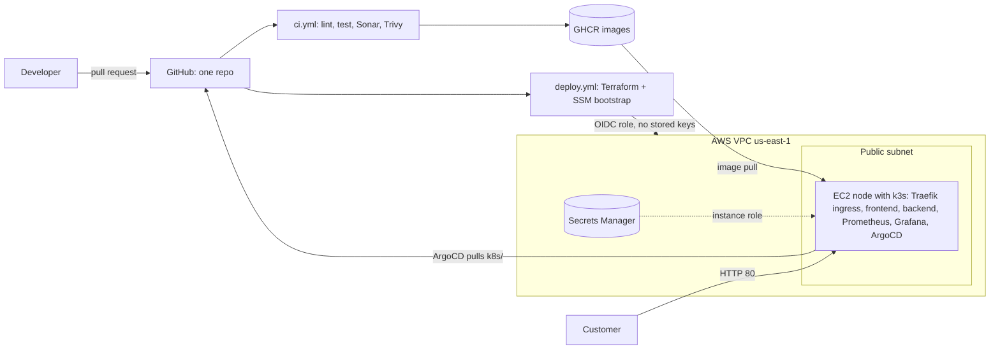

# Zuri Market DevOps Capstone

Zuri Market is a small online store. This repository takes its two starter apps and builds the platform around them: one repository, two workflows, Terraform on AWS, Docker, Kubernetes (k3s), GitOps with ArgoCD, Prometheus and Grafana, and secrets in AWS Secrets Manager.

Starter code credit: [`Test-class2026/zuriapp-backend`](https://github.com/Test-class2026/zuriapp-backend) and [`Test-class2026/zuriapp-frontend`](https://github.com/Test-class2026/zuriapp-frontend).

## 1. The problems Zuri had

<!-- align the wording with the Student Project Brief -->
1. **Everyone pushed straight to `main`.** No review, no history of why things changed.
2. **Nobody could say who had SSH access** to the servers.
3. **Secrets lived in files and chat**, not in a managed store.
4. **No monitoring and no safe rollback.** `pm2 logs` was the only signal, and one bad release meant a six-hour outage.

Each one is answered below: protected `main` and PR review, SSM instead of SSH, Secrets Manager, Prometheus and Grafana with rolling updates and Git-based rollback.

## 2. Architecture



## 3. Repository structure

```
backend/                 Express API + Dockerfile, tests, ESLint config
frontend/                React + Vite app + Dockerfile, nginx.conf
terraform/
  bootstrap/             S3 bucket for remote state (applied once, local state)
  ci-access/             GitHub OIDC provider and the two CI roles (applied once)
  modules/               network, security, compute, secrets
  environments/dev|prod/ same modules, different variables
k8s/                     Namespace, RBAC, Ingress; backend/ and frontend/ manifests
argocd/                  ArgoCD Applications (shared, backend, frontend)
monitoring/              Helm values, ServiceMonitor, Grafana dashboard JSON
scripts/                 sync-secrets.sh, set-image.sh, deploy-on-node.sh
docs/                    Jenkins vs GitHub Actions comparison
.github/workflows/       ci.yml, deploy.yml  (+ dependabot.yml)
docker-compose.yml       Whole stack locally
```

Each app folder has its own README with its configuration and container details: [backend](backend/README.md), [frontend](frontend/README.md).

## 4. Run locally (Docker Compose)

```bash
cp .env.example .env          # fake local values, git-ignored
docker compose up --build -d
docker compose ps             # backend should become "healthy"
```

Open http://localhost:8080. Without Docker, see the two app READMEs (backend on 5000, frontend dev server on 3000).

| Fact | Value |
|---|---|
| Backend port | 5000 |
| Compose frontend port | 8080 |
| Frontend dev server port | 3000 |
| Secret variable and header | `API_SECRET_KEY`, header `x-api-key` |
| Health endpoint | `GET /api/health` |
| Metrics endpoint | `GET /metrics` (not exposed by the Ingress) |

## 5. Run in the cloud

Prerequisites: AWS CLI with an SSO or MFA identity (never root), Terraform 1.11 or newer, the Session Manager plugin.

1. **Remote state bucket** (once): `terraform/bootstrap`, `terraform apply -var region=<region> -var bucket_name=<unique-name>`.
2. **CI access** (once): `terraform/ci-access` creates the GitHub OIDC provider and two roles, `gha-zuri-infra` and `gha-zuri-deploy`. Store the two role ARNs as the repository variables `AWS_INFRA_ROLE_ARN` and `AWS_DEPLOY_ROLE_ARN`. Add the `SONAR_TOKEN` secret.
3. **Deploy**: merging to `main` (or running the `deploy` workflow) provisions the dev environment with Terraform, seeds the secret value, and bootstraps the node over SSM. It installs the monitoring stack and ArgoCD, which then syncs `k8s/` from Git.
4. **Reach the node**: `aws ssm start-session --target <instance-id>`. There is no SSH key and no port 22.

The `deploy` workflow can also run `destroy` and then `apply`, which rebuilds the whole environment from Git.

## 6. CI/CD

**`ci.yml`** (pull requests and pushes to `main`) has five jobs: `Backend - lint, test`, `Frontend - lint, test`, `Sonar - quality gate`, `Backend - build, scan, push`, `Frontend - build, scan, push`.

- The cheap checks run first: lint, tests, `npm audit`, the SonarCloud quality gate. Image builds wait for them.
- Images are built, scanned with Trivy (fails on CRITICAL or HIGH), and **only pushed from `main`**.
- Tags are `sha-<7 chars>` plus `latest`. Manifests use the `sha-` tag only, so every running image maps to one commit.
- Third-party actions are pinned to full commit SHAs, after the March 2026 compromise of the Trivy action's version tags. Dependabot proposes updates.
- The `paths` filter on push excludes `k8s/`, so merging a promotion PR never rebuilds images.

**`deploy.yml`** has two jobs: `infra` (Terraform through the `gha-zuri-infra` role) and `deploy` (runs `deploy-on-node.sh` on the node through SSM, with the `gha-zuri-deploy` role). Authentication is OIDC; no AWS keys are stored in GitHub, and only the `main` branch can assume the roles.

## 7. Security

- **Branch protection:** ruleset on `main` requiring a pull request, required status checks, no force pushes. Secret scanning and push protection are on.
- **Secrets:** Terraform creates only the empty Secrets Manager secret; the value is generated by the pipeline and never enters Terraform state or Git. The node's instance role can read `zuri/<env>/backend` and nothing else. `sync-secrets.sh` turns it into the Kubernetes Secret `backend-secrets`.
- **Network:** the security group allows only port 80. No SSH, no key pair; access is SSM Session Manager, which logs every session.
- **Node:** IMDSv2 required, encrypted gp3 volume.
- **Kubernetes RBAC:** pods get no API token. The `ci-deployer` service account can patch deployments but cannot delete pods or read secrets.
- **Containers:** non-root, read-only root filesystem on the backend, all capabilities dropped, resource limits.
- **Scans:** `npm audit`, SonarCloud quality gate, Trivy image scan.
- **Known limit:** a Kubernetes Secret is base64, not encrypted at rest, unless k3s secrets encryption is enabled.

## 8. Monitoring

kube-prometheus-stack (Prometheus and Grafana, Alertmanager off) is installed by the deploy script with `monitoring/values.yaml`. A `ServiceMonitor` scrapes the backend's `/metrics` every 15 seconds. The **Zuri Market Overview** dashboard is provisioned from `monitoring/dashboards/zuri-overview.json` and shows request rate, error rate, p95 latency and pod restarts. Grafana and Prometheus are not exposed to the internet; reach Grafana through an SSM port-forward.

## 9. GitOps with ArgoCD

ArgoCD runs in the cluster and pulls `k8s/` from `main` through three Applications (`argocd/`): shared files, backend and frontend, with automated sync, prune and self-heal. A promotion is a pull request that changes an image tag (`scripts/set-image.sh`); after the merge ArgoCD syncs it with no `kubectl apply`. A rollback is reverting that PR. The Secret is created from Secrets Manager and is not tracked by ArgoCD, so it is never pruned.

## 10. Jenkins vs GitHub Actions

See [docs/jenkins-vs-github-actions.md](docs/jenkins-vs-github-actions.md). Short version: a three-developer team with no operations staff is better served by the managed, in-repo, PR-integrated model.

## 11. Troubleshooting log

| Problem | Cause | Fix |
|---|---|---|
| `npm install` of the ESLint React plugin failed with `ERESOLVE` | `eslint-plugin-react` does not support ESLint 10 yet | Pin `eslint@9` and `@eslint/js@9` in the frontend |
| Production frontend called `localhost:5000` | `VITE_API_URL \|\| "http://localhost:5000"`: an empty build arg is falsy | Changed to `??` so empty means same origin |
| Backend `.env.example` listed frontend variables | Starter repo mistake | Replaced with `PORT`, `API_SECRET_KEY`, `STORE_NAME` |
| `ImagePullBackOff` right after the first deploy | A 64-character image digest was used as the tag | Use the real `sha-<7 chars>` tag from GHCR |
| Terraform: availability zone `a` invalid, empty `AWS_DEFAULT_REGION` | `$REGION` was unset when `prod.tfvars` was written | Exported variables in `~/.bashrc`, corrected the tfvars |
| `terraform init` took very long | The AWS provider is downloaded for each stack | Shared plugin cache (`TF_PLUGIN_CACHE_DIR`) |
| GitHub Actions could not assume the AWS role | The token's `sub` claim is ID-based (`repo:owner@<id>/repo@<id>:ref:...`), not the plain form | Trust policy now accepts both subject formats, still only for `main` |
| `terraform apply` for `ci-access` rejected a variable | `$CREATE_OIDC` was empty in a new shell | Set it explicitly and persisted it |

## 12. Not done yet, and what I would do differently

- The daily health-check script with cron is not implemented yet.
- **One thing I would do differently:** put the node in a private subnet behind an ALB with a domain and HTTPS (and a NAT gateway for outbound traffic), enable k3s secrets encryption at rest, and move to External Secrets Operator.
